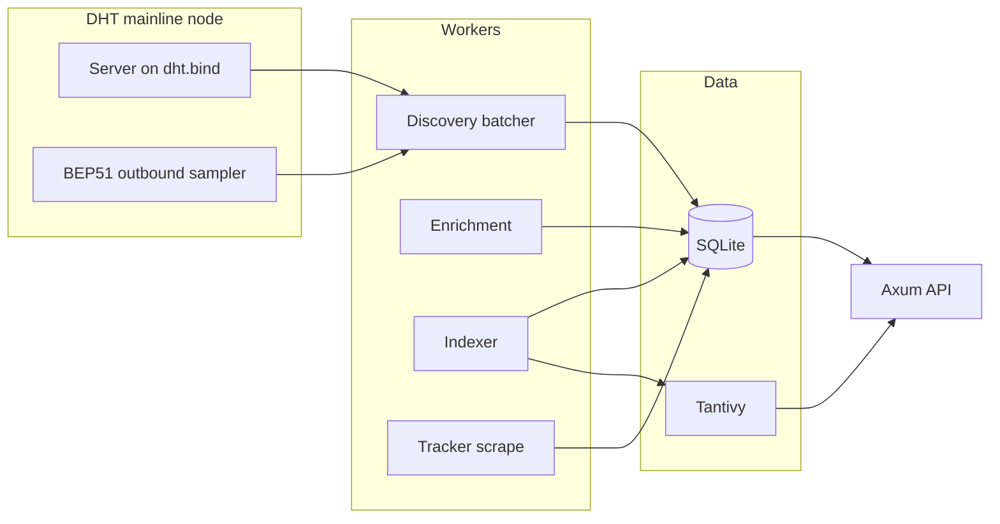

# bt-scraper code map

BitTorrent DHT indexer: discover infohashes, fetch metadata, persist in SQLite, classify, index (Tantivy), optional mirrors, tracker scrape, HTTP API.

See [Architecture.md](Architecture.md) for architecture and configuration.

## High-level architecture

## Repository layout

| Path | Role |
|------|------|
| `src/app/` | Runtime wiring, shutdown, HTTP serve |
| `src/dht/` | Mainline node, BEP 51 client, discovery filter |
| `src/ports/` | `DhtPeerLookup` trait (`ports/dht.rs`) |
| `src/workers/` | `discovery`, `enrichment`, `indexer`, `scrape` |
| `src/domain/` | Pipeline domain helpers (`may_schedule_enrichment`) |
| `src/peer_policy.rs` | Public routable peer rules |
| `src/enrich.rs` | Re-exports discovery/enrichment worker API |
| `src/lib.rs` | `indexer` and `scrape` module re-exports for stable imports |
| `src/store/` | SQLite facade, writer thread, `sql/` modules |
| `src/search.rs` | Tantivy index |
| `src/api.rs` | HTTP handlers |
| `src/backends/` | Postgres and Meilisearch mirrors |
| `config/` | `default.toml`, `test.toml`, `classification.toml` |
| `logs/` | Service log target (e.g. `scraper.log`; gitignored) |
| `tests/` | Integration tests |
| `scripts/` | `test-all.sh`, `test-live.sh`, `show-discovered.sh` |

## Entry points

- `src/main.rs` — CLI (`run`, `stats`, `backfill`, `reindex`, `export`)
- `src/app/mod.rs` — `run(config)` starts all workers and API

## Core modules

| Module | Responsibility |
|--------|----------------|
| `types.rs` | `InfoHash`, peers, statuses, metadata |
| `config.rs` | TOML `Config` |
| `commands.rs` | CLI maintenance commands |
| `wire.rs` | BitTorrent `ut_metadata` over TCP |
| `tracker.rs` | HTTP/UDP announce and scrape |
| `classify.rs` / `classification_config.rs` | Blocklist, content type, tags |
| `routing.rs` | DHT bootstrap JSON snapshot |
| `metrics.rs` | Prometheus metric descriptions |

## DHT (`src/dht/`)

| File | Role |
|------|------|
| `engine.rs` | Build mainline server node, find_node burst, routing persistence, peer lookup |
| `sampler.rs` | Outbound BEP 51 sampling loop and live test helper |
| `krpc/` | `sample_infohashes` KRPC client and encode/decode |
| `sample_store.rs` | LRU info-hash pool (discovery + future BEP 51 server) |
| `discovery.rs` | Inbound get_peers / announce_peer parsing |
| `discovery_filter.rs` | `RequestFilter` wiring discovery + sample store |

## Workers (`src/workers/`)

| File | Role |
|------|------|
| `discovery.rs` | Discovery batcher → store, optional enrich queue |
| `enrichment.rs` | Pool, scheduler, retries, peer prune |
| `indexer.rs` | Tantivy index loop and `index_batch` |
| `scrape.rs` | Tracker scrape loop for swarm stats |

## Store (`src/store/sql/`)

| Module | Role |
|--------|------|
| `schema.rs` | Open connections, migrations, startup reset |
| `discovery.rs` | Discovery batch writes |
| `peers.rs` | Peer upsert and read |
| `torrent.rs` | Status, enrichment, retry queue |
| `index.rs` | Index candidates and indexed flags |
| `stats.rs` | Counts and breakdowns |
| `swarm.rs` | Tracker scrape candidates and stats updates |
| `row.rs` | Row parsing helpers |

Peers are upserted only when `peer_policy::is_storable_peer` passes.

## Tests

| File | Focus |
|------|-------|
| `tests/integration.rs` | Config, store, search; ignored live DHT test |
| `tests/discovery.rs` | BEP51 vs announce batching |
| `tests/peer_policy_store.rs` | Private peers not stored |
| `tests/pipeline.rs` | Index and scrape lifecycle |
| `tests/api_handlers.rs` | HTTP handlers |
| `tests/routing.rs` | Routing table file |

Run `./scripts/test-all.sh` for the default CI-style suite (live DHT test ignored).

## Docker

- `Dockerfile` — release binary; config reference at `/etc/bt-scraper/config.toml`; runtime config `/data/config.toml`
- `docker-compose.yml` — scraper + optional Postgres and Meilisearch
